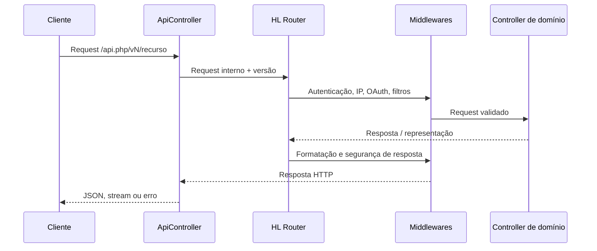

# APIs, protocolos e contratos HTTP

## Superfícies de entrada

| Superfície | Entrada | Implementação |
| --- | --- | --- |
| REST legada | `/apirest.php/...` e alias `/api.php/v1/...` | [APIRest](../src/Glpi/Api/APIRest.php), [API](../src/Glpi/Api/API.php) |
| API de alto nível (HL) | `/api.php/...` ou `/api.php/v<versão>/...` | [ApiController](../src/Glpi/Controller/ApiController.php), [Router](../src/Glpi/Api/HL/Router.php) |
| GraphQL | `/api.php/GraphQL/` | [GraphQLController](../src/Glpi/Api/HL/Controller/GraphQLController.php) |
| Inventário | `/Inventory`, `/front/inventory.php` e compatibilidade com agentes | [InventoryController](../src/Glpi/Controller/InventoryController.php), listener de agentes |
| CalDAV | `/caldav.php...` | [CaldavController](../src/Glpi/Controller/CaldavController.php) e `src/Glpi/CalDAV/` |
| Web/AJAX interno | `/front/...`, `/ajax/...` e rotas Symfony | Controllers/handlers de interface; não são contratos públicos equivalentes à API HL |

Os caminhos precisam do prefixo de instalação se o GLPI estiver em subdiretório. Inventários: [API_ROUTES.md](API_ROUTES.md), [WEB_ROUTES.md](WEB_ROUTES.md) e [CODE_INDEX.md](CODE_INDEX.md) para scripts legados.

## REST legada

A implementação despacha recursos como `initSession`, `killSession`, perfil/entidade e operações sobre itemtypes. O contrato detalhado acompanha o código em [apirest.md](../apirest.md). Habilitação e modos de autenticação dependem de `enable_api`, `enable_api_login_credentials` e `enable_api_login_external_token`.

`Authorization: user_token ...` ou credenciais autorizadas podem inicializar sessão. Requests subsequentes usam `Session-Token`; `App-Token` identifica o cliente quando exigido/configurado. Não confundir esses tokens com access tokens OAuth da API HL. Filtros de cliente, IP e direitos continuam aplicáveis.

Exemplo conceitual, com variáveis fornecidas fora do Git:

```bash
curl --get "$GLPI_BASE/apirest.php/Ticket/123" \
  -H "Session-Token: $GLPI_SESSION_TOKEN" \
  -H "App-Token: $GLPI_APP_TOKEN"
```

Esse exemplo requer API habilitada, sessão válida, item existente e direitos adequados; não foi usado para ativar ou alterar configurações durante o mapeamento.

## API HL e versionamento

O roteador declara versão padrão **3.0.0** neste snapshot. A versão do GLPI (`12.0.2-dev`) é diferente da versão da API. `ApiController` extrai o prefixo de versão, normaliza-o e encaminha a requisição ao roteador próprio. `/api.php/v1/...` segue o caminho legado, não o HL.

O snapshot contém **570 declarações de rota únicas**, reunindo todas as versões registradas. O catálogo distingue `introduced`, `deprecated` e `removed`. Não significa que todas estejam disponíveis em uma única versão ou para um usuário específico.

Os controllers HL agrupam ativos, componentes, ITIL, administração, gestão, projetos, listas, regras, relatórios, notificações, inventário e segurança. Exemplos de contratos:

| Caminho HL relativo | Finalidade |
| --- | --- |
| `GET /doc`, `GET /doc.json` | Interface Swagger e contrato OpenAPI |
| `GET/POST /authorize`, `POST /token` | Autorização/emissão OAuth |
| `GET /session`, `GET /Session/EntityTree` | Contexto da sessão/entidades |
| `GET /status`, `GET /status/all`, `GET /status/{service}` | Diagnóstico de serviços com regras próprias |
| `POST /GraphQL/`, `GET /GraphQL/Schema` | Consulta GraphQL e schema |

Os demais caminhos e métodos estão no catálogo por controller. Schemas, filtros, paginação e validação são definidos em `Api/HL/Doc/`, `Schemas`, `Search`, `RSQL`, `ResourceAccessor` e atributos dos métodos. Não gerar um cliente a partir de exemplos isolados: usar o OpenAPI da versão desejada.

## Autenticação e autorização HL

A infraestrutura OAuth fica em [src/Glpi/OAuth/](../src/Glpi/OAuth/). Middleware valida tokens e escopos, restrições de IP e contexto da requisição. A rota pode exigir scopes como `api`, `graphql` ou `status`, além de direitos de usuário/entidade. O roteador também suporta autenticação interna e cookie em rotas explicitamente configuradas.

`Route::SECURITY_NONE` não garante disponibilidade pública quando a API está desabilitada. [Config::isHlApiEnabled](../src/Config.php) consulta `enable_hlapi`, e o roteador possui tratamento específico para API desabilitada. Existência do código não demonstra habilitação no ambiente.

## Pipeline HL



## Limites do catálogo

A introspecção descreve contratos registrados sem realizar CRUD de negócio. Não houve ativação de API, criação de cliente OAuth, extração de token nem testes de cada endpoint. Plugins podem acrescentar rotas; schemas e direitos podem reduzir recursos disponíveis. A camada web inclui rotas Dev de profiler e resolução dinâmica de scripts legados; esses endpoints não devem ser transportados para integrações externas como se fossem uma API estável.
