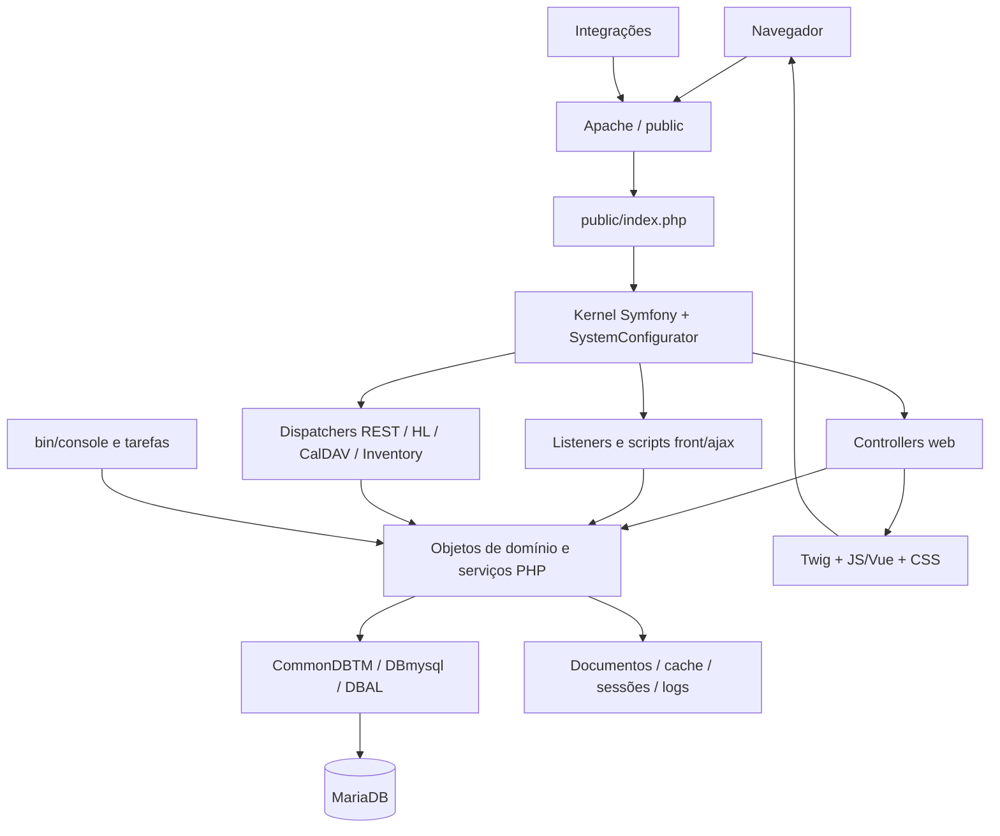

# Arquitetura do GLPI Arbos

## Escopo e versão

Este mapa descreve o código GLPI `12.0.2-dev` presente na base `da39b904ef` e os ambientes deste host. O nome Arbos identifica o repositório de trabalho; os domínios funcionais continuam sendo os do GLPI upstream. Os inventários são snapshots, não uma promessa de compatibilidade com versões futuras.

O sistema é um monólito modular PHP: interface web, regras de negócio, APIs, console e tarefas compartilham classes e banco relacional. Não há serviços independentes por domínio nem uma aplicação SPA que substitua toda a interface. Controllers Symfony coexistem com scripts e objetos legados.

## Inicialização e processamento HTTP

1. [public/index.php](../public/index.php) verifica a versão PHP e os recursos da aplicação, carrega `vendor/autoload.php` e cria `Glpi\Kernel\Kernel`.
2. [SystemConfigurator](../src/Glpi/Application/SystemConfigurator.php) resolve constantes, ambiente, diretórios, logging, erros e sessões. Configurações locais podem ser carregadas; não devem ser copiadas entre os ambientes.
3. [Kernel](../src/Glpi/Kernel/Kernel.php) registra bundles, importa serviços e rotas e dispara eventos de inicialização. Em Dev habilita recursos de debug conforme `Environment`.
4. Symfony resolve controllers e listeners. Scripts antigos são tratados por bridges/listeners; o front controller continua sendo o ponto público de entrada.
5. O domínio verifica permissões e entidades, consulta/atualiza dados e produz HTML/Twig, JSON, downloads ou streams. Resposta enviada e terminada pelo kernel.

Não se deve criar atalhos públicos que contornem esse bootstrap, a sessão e as verificações de acesso.

## Camadas e responsabilidades

| Camada | Implementação | Responsabilidade |
| --- | --- | --- |
| Entrada HTTP | `public/`, `src/Glpi/Controller/` | Receber requests e adaptar respostas |
| Compatibilidade | `front/`, `ajax/`, `inc/`, listeners | Manter páginas, handlers e convenções históricas |
| Domínio | classes de `src/` e módulos de `src/Glpi/` | Ativos, ITIL, usuários, formulários, documentos, regras |
| Persistência | `CommonDBTM`, `DBmysql`, `src/Glpi/DBAL/` | Modelo de objetos e composição/execução de consultas |
| Apresentação | `templates/`, `src/Twig/`, `js/`, `css/` | Renderização Twig, componentes e interação |
| Contratos externos | `src/Glpi/Api/`, `OAuth/`, `CalDAV/`, `Inventory/` | Protocolos e representações de integração |
| Operação | `bin/console`, `CronTask`, containers | Instalar, migrar, diagnosticar e executar rotinas |

A persistência é própria do GLPI; não presumir um modelo Doctrine ORM. Muitos objetos também contêm regras de UI e busca, além da gravação de dados.

## Injeção, eventos e extensões

[dependency_injection/services.php](../dependency_injection/services.php) configura autowiring/autoconfiguration e registra controllers, listeners e serviços de módulos específicos. Nem todas as classes legadas são serviços do container. As configurações de framework, Twig e profiler ficam nos demais arquivos dessa pasta.

Os listeners em [src/Glpi/Kernel/Listener](../src/Glpi/Kernel/Listener/) tratam bootstrap, banco, manutenção, roteamento legado, sessão, CSRF, autenticação, assets e exceções. Plugins também podem acrescentar hooks, controllers e middleware. Detalhes em [EXTENSIBILITY.md](EXTENSIBILITY.md).

## Fronteiras de implantação

Dev monta o checkout em `/var/www/glpi`. Prod empacota o código e dependências em uma imagem por commit, com `GLPI_ENVIRONMENT_TYPE=production`. Ambos estão neste host, com redes e persistência Docker separadas. MariaDB é um serviço por ambiente; Mailpit atende Dev. Não há Redis, balanceador, cluster ou broker configurado nos arquivos de implantação atuais.

Os diretórios de cache e sessões, as chaves e os documentos fazem parte do estado de cada ambiente; a imagem não substitui backup desses dados. Veja [OPERATIONS.md](OPERATIONS.md), [CONFIGURATION.md](CONFIGURATION.md) e [DATABASE.md](DATABASE.md).
