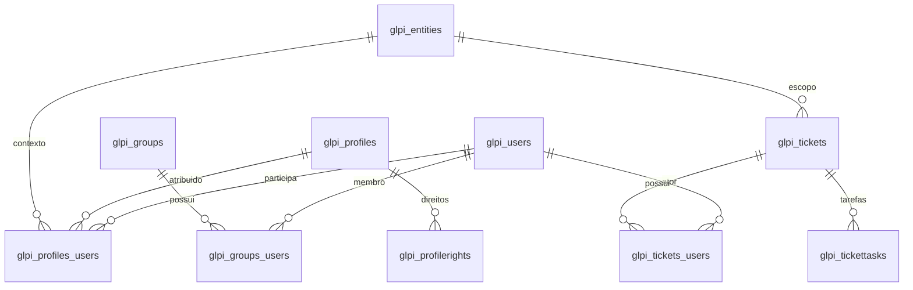

# Banco de dados e persistência

## Fontes e estrutura verificada

O esquema de instalação atual está em [install/mysql/glpi-empty.sql](../install/mysql/glpi-empty.sql): **447 tabelas, 4.748 colunas** no snapshot documentado. O catálogo em [DATABASE_SCHEMA.md](DATABASE_SCHEMA.md) contém todas as tabelas, definições de colunas, índices e opções DDL. O banco Dev foi consultado somente para metadados: foram encontradas as mesmas 447 tabelas; registros de usuários, chamados, tokens e configurações privadas não foram exportados.

Os containers usam MariaDB `11.8`. O DDL declara InnoDB, `utf8mb4`, collation `utf8mb4_unicode_ci` e formato DYNAMIC, com variações de espaçamento. Não há declarações `FOREIGN KEY (...)` no DDL atual. Índices de colunas de relacionamento não devem ser confundidos com constraints referenciais.

## Modelo de persistência

[DBmysql](../src/DBmysql.php) fornece a conexão e execução SQL; [src/Glpi/DBAL/](../src/Glpi/DBAL/) contém estruturas de consulta. [CommonDBTM](../src/CommonDBTM.php) fornece o ciclo de vida de objetos persistidos e pontos de extensão. Não há adoção geral de Doctrine ORM.

A classe local `DB` é gerada em `config/config_db.php` e estende `DBmysql`. Esse arquivo contém credenciais e não é parte do mapeamento versionado. Os valores do banco Prod estão em arquivo privado fora do checkout.

## Convenções do esquema

| Convenção | Interpretação |
| --- | --- |
| Prefixo `glpi_` | Tabelas do núcleo |
| `id` | Identificador do registro; verificar PK específica no dicionário |
| `entities_id` | Escopo de entidade organizacional; semântica depende do modelo |
| `is_recursive` | Visibilidade/uso em subentidades quando suportado |
| `is_deleted` | Exclusão lógica em objetos que suportam lixeira |
| `date_creation`, `date_mod` | Datas de criação e atualização quando presentes |
| `<objetos>_id` | Referência por convenção; não comprova FK física |
| `itemtype` + `items_id` | Referência polimórfica: tipo/classe mais ID |
| Tabelas de associação | Relações entre objetos, atores, documentos, grupos e perfis |

Relações também são declaradas no [mapa da aplicação](../inc/relation.constant.php), catalogado integralmente em [DATABASE_RELATIONS.md](DATABASE_RELATIONS.md). A aplicação decide validação, limpeza e cascatas; não atribuir essa responsabilidade automaticamente ao banco.

## Núcleos de dados

| Domínio | Tabelas de referência |
| --- | --- |
| Identidade e direitos | `glpi_users`, `glpi_profiles`, `glpi_profilerights`, `glpi_profiles_users`, `glpi_entities`, `glpi_groups`, `glpi_groups_users` |
| ITIL | `glpi_tickets`, `glpi_changes`, `glpi_problems`, `glpi_itilfollowups`, `glpi_itilsolutions`, `glpi_tickettasks`, `glpi_tickets_users`, `glpi_groups_tickets` |
| Ativos | `glpi_computers`, `glpi_monitors`, `glpi_printers`, `glpi_networkequipments`, `glpi_phones`, `glpi_peripherals` |
| Software | `glpi_softwares`, `glpi_softwareversions`, `glpi_softwarelicenses`, `glpi_items_softwareversions`, `glpi_items_softwarelicenses` |
| Documentos e histórico | `glpi_documents`, `glpi_documents_items`, `glpi_logs` |
| Financeiro e gestão | `glpi_infocoms`, `glpi_budgets`, `glpi_contracts`, `glpi_suppliers`, `glpi_contacts`, `glpi_projects`, `glpi_projecttasks` |
| Formulários | `glpi_forms_forms`, `glpi_forms_sections`, `glpi_forms_questions`, `glpi_forms_answerssets`, `glpi_forms_destinations_formdestinations` |
| OAuth | `glpi_oauth_access_tokens`, `glpi_oauth_refresh_tokens` e tabelas relacionadas |
| Regras e automações | `glpi_rules`, `glpi_rulecriterias`, `glpi_ruleactions`, `glpi_crontasks`, `glpi_crontasklogs` |
| Configuração e integração | `glpi_configs`, `glpi_apiclients`, `glpi_authldaps`, `glpi_notifications`, `glpi_notificationtemplates` |

Campos opcionais e tabelas especializadas são detalhados no dicionário completo. Objetos modernos namespaced possuem tabelas próprias; não inferir o nome da tabela apenas removendo o namespace.

## Diagrama lógico de identidade e atendimento

As arestas abaixo representam vínculos lógicos por convenção/aplicação, **não** constraints SQL físicas.

## Instalação, migração e integridade

- [install/empty_data.php](../install/empty_data.php): dados iniciais, perfis, regras e definições necessárias à instalação.
- [install/migrations/](../install/migrations/): histórico de atualizações. Arquivos de versões antigas não definem, isoladamente, o esquema atual.
- [src/Migration.php](../src/Migration.php) e comandos de `src/Glpi/Console/Database/`: execução e diagnóstico do banco.
- `database:install`: cria estrutura/configuração; não usar para atualizar um ambiente com dados.
- `database:update`: atualiza uma instalação; analisar parâmetros e compatibilidade no `--help` da versão atual.
- `database:check_schema_integrity`: compara a estrutura instalada com a referência esperada; é diagnóstico, não uma migração.

Em Prod, backup antes de migrations e análise de rollback são obrigatórios. A reversão da imagem não reverte tabelas nem dados. Dump do banco sem documentos/chaves não constitui backup completo. Nunca usar o banco Prod para as suítes de teste.

## Separação local

| Ambiente | Serviço | Persistência |
| --- | --- | --- |
| Dev | `glpi-db-1` | volume `glpi_db` |
| Prod | `glpi-prod-db-1` | volume `glpi-prod_db` |

Os dois bancos se chamam `glpi` dentro de containers diferentes; isso não os torna o mesmo banco. Sem porta 3306 publicada no host nos arquivos Compose atuais. Dados não são sincronizados entre Dev e Prod.
