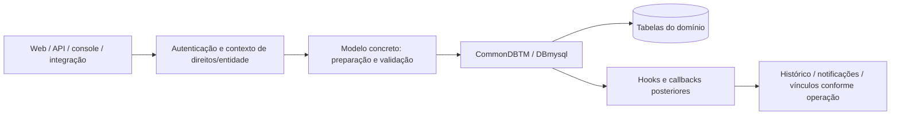

# Fluxos de dados e efeitos de negócio

Os fluxos abaixo descrevem o percurso estrutural observado nas classes, não todos os ramos de cada operação. Referências completas em [CODE.md](CODE.md), [MODULES.md](MODULES.md) e [DATABASE.md](DATABASE.md).

## Criação/alteração de um objeto

`CommonDBTM::add`, `update` e `delete` coordenam fases do ciclo de vida. Nem todo objeto gera todos os efeitos; métodos concretos podem acrescentar validações e relações. Escritas SQL diretas podem contornar esse percurso.

## Atendimento ITIL

Entrada pela interface, API, formulário ou e-mail → normalização/validação no caminho específico → `Ticket`/`CommonITILObject` → objeto ITIL, atores e relações → acompanhamento, tarefas, validações e solução conforme o fluxo do item. Regras podem definir atribuição, classificação e outros valores.

Permissões, entidade e estado do chamado influenciam ações disponíveis. Uma alteração em ator, prazo ou status pode afetar notificações, SLA/OLA, estatísticas e histórico; validar esses efeitos quando fizerem parte do pedido.

## Formulários e destinos

Controller de formulário → acesso ao formulário → seções/perguntas → motor de condições/validação → conjunto de respostas → handlers/destinos configurados. Os modelos e serviços estão em `src/Glpi/Form/`, incluindo `AnswersHandler/`, `Condition/` e `Destination/`.

Exibir ou esconder uma pergunta não é, por si só, validação de input no servidor. O destino define o resultado da submissão; não presumir que todo formulário apenas crie um ticket.

## Inventário

Request de agente → listener/controller de inventário → `Glpi\Inventory\Inventory` e classes especializadas → regras/reconciliação → criação/atualização de ativos, componentes e vínculos. Identificadores e regras de importação determinam associação ou criação de itens.

A existência do endpoint não comprova configuração de agentes. Testes de inventário podem alterar muitos objetos: usar payload/fixtures controlados em Dev.

## Documentos e anexos

Upload → validação do handler/modelo → conteúdo físico em diretório de documentos → metadados em `glpi_documents` → associação em `glpi_documents_items` quando aplicável. Download exige controle de acesso; um caminho físico não deve virar URL pública irrestrita.

Um dump do banco sem os arquivos gera metadados sem conteúdo. Copiar documentos sem as chaves/configuração ou sem registros coerentes também não reproduz a instalação.

## E-mail e notificações

Coleta: servidor de mensagens configurado → `MailCollector` e regras → operação de atendimento apropriada → registro/resultado do processamento.

Envio: evento de domínio → seleção de notificação/alvos/template → preparação/fila conforme o canal → execução da rotina de envio → logs/resultados. Configuração SMTP, credenciais e tarefas não foram ativadas ou modificadas durante este mapeamento.

## Busca e representação

Critérios/perfil/entidade → mecanismos de busca e opções dos objetos → consulta → linhas/contagens/representação. A API HL adiciona schemas, filtros e formatação próprios. Coluna no banco, campo no formulário e campo na API não são necessariamente uma exposição de um para um.

## Exclusão e purge

Pedido de exclusão → autorização e estado → verificação de relações → exclusão lógica ou purge conforme suporte/operação → tratamento de filhos/associações e hooks. O mapa `inc/relation.constant.php` e métodos específicos participam da limpeza. Sem foreign keys DDL no esquema atual, não pressupor cascatas garantidas pelo servidor SQL.
